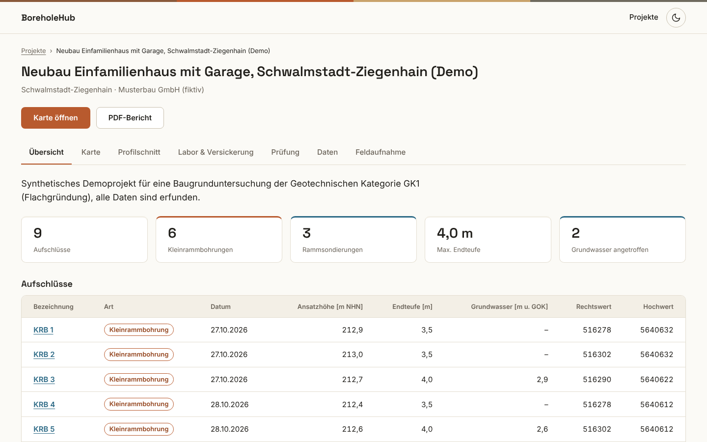
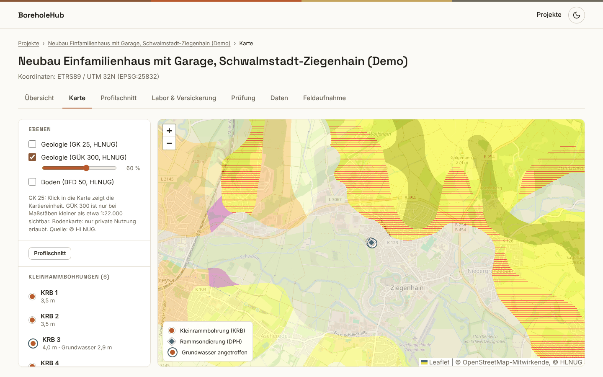
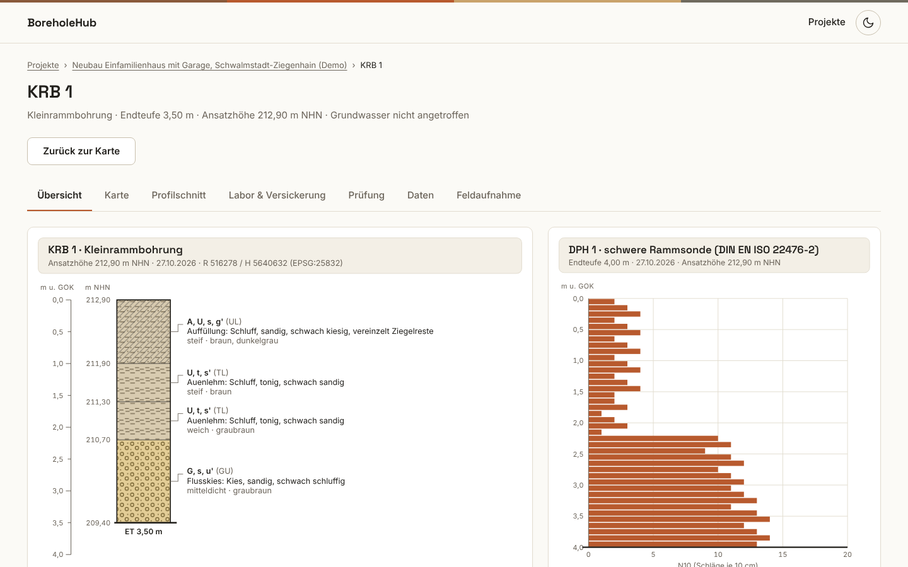
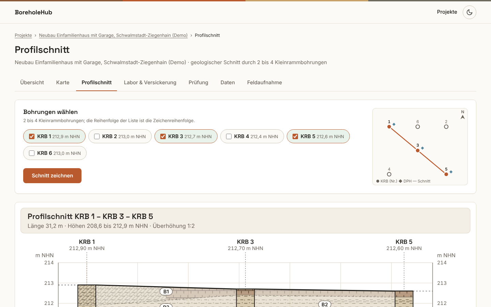
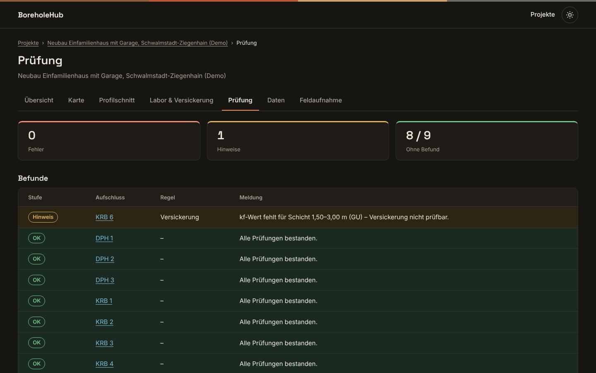
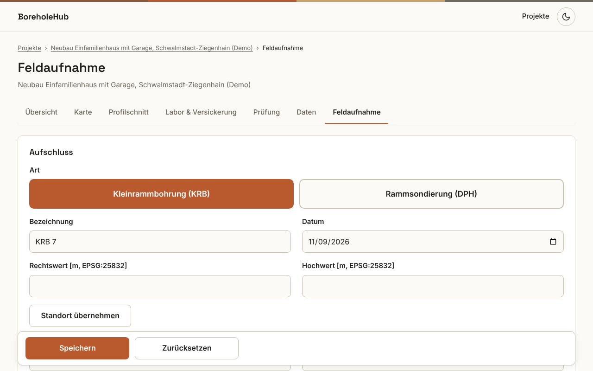

# BoreholeHub

Deutsche Version: [README.md](README.md)

Demo for a ground-investigation / engineering-geology office (GK1): Kleinrammbohrungen (KRB), Rammsondierungen (DPH), map, cross-section, data check and PDF reports.



## Features

- **Start:** The button "Demo-Projekt laden" (load demo project) creates a project with synthetic data.
- **Projekte (projects):** List of all projects.
- **Übersicht (overview):** Key figures, a table of the boreholes, and the button "PDF-Bericht" (PDF report).
- **Karte (map):** Leaflet map on OpenStreetMap. You can add the HLNUG layers GK 25, GÜK 300 and the soil map BFD 50, each with an opacity slider. Clicks open popups.
- **Profilschnitt (cross-section):** Geological cross-section through two to four selected Kleinrammbohrungen.
- **Labor & Versickerung (lab and infiltration):** Example classification by the EBV classes BM-0 to BM-F3, and a simplified infiltration pre-check.
- **Prüfung (data check):** Data quality check with errors, notes and boreholes without findings.
- **Daten (data):** CSV templates and CSV import, plus GeoJSON export.
- **Feldaufnahme (field form):** Form for tablets. It records layers for KRB and blow counts N10 for DPH. The position can be taken over with "Standort übernehmen".
- **Aufschluss (borehole log):** Borehole log in a simplified style of DIN 4023, and a blow-count chart for the ramming sounding.
- **Display:** Light and dark mode.

## Quick start

### A: SQLite (default)

You need the .NET 8 SDK. In the repository folder, run:

```
dotnet run --project src/BoreholeHub.Web
```

The console prints `Now listening on: http://localhost:5000`. Open that address and click "Demo-Projekt laden". The database is the file `boreholehub.db`. It is created in the folder `src/BoreholeHub.Web` on the first start.

### B: Windows package with SQL Server

The package is called `BoreholeHub-1.0.0-win-x64`. Its `appsettings.json` sets `Database:Provider` to `SqlServer` and uses the connection string `Server=.;Database=BoreholeHub;Trusted_Connection=True;TrustServerCertificate=True`. The file `Start-BoreholeHub.cmd` then opens `http://localhost:5080`.

## Tests

```
dotnet test
```

There are currently 180 tests, and all of them pass. The tests use xUnit. For them, the web app is started through `WebAppFactory`.

## Tech stack

- .NET 8 (`net8.0`), ASP.NET Core Razor Pages, C# with nullable reference types enabled. The version 1.0.0 is set in `Directory.Build.props`.
- Entity Framework Core 8.0.33 with SQLite (default) and SQL Server. The application creates the schema at startup with `EnsureCreated`.
- QuestPDF 2026.9.1 generates the PDF report.
- The drawings (borehole log, cross-section, ramming chart, site plan) are SVG created on the server.
- Leaflet is included locally under `wwwroot/lib/leaflet`. The web interface loads the fonts Inter and Space Grotesk from Google Fonts.
- Project layout: `src/BoreholeHub.Core` (entities, services), `src/BoreholeHub.Web` (Razor Pages, drawings, import, PDF), `tests/BoreholeHub.Tests`.
- Tests with xUnit 2.5.3 and Microsoft.AspNetCore.Mvc.Testing 8.0.33.

## Domain notes

- The investigation points are Kleinrammbohrungen (KRB) and Rammsondierungen (DPH) of geotechnical category GK1 with a final depth of up to 4 m.
- The presentation follows these standards in a simplified way, "in Anlehnung, vereinfacht": DIN 4023:2023-02 (layer description and borehole log), DIN 18300:2019-09 (homogeneous areas) and DIN EN ISO 22476-2 (DPH).
- The EBV classes BM-0 to BM-F3 are shown with invented example limit values. They are not the legal values.
- On infiltration, the app says: "Vereinfachte Vorprüfung: Der kf-Wert ersetzt keine Bemessung nach DWA-A 138-1." (Simplified pre-check: the kf value does not replace a design according to DWA-A 138-1.)
- All project data is synthetic and invented.

## Screenshots

| | |
|---|---|
|  02 Map with GÜK 300 |  03 Borehole log KRB 1 |
|  04 Cross-section |  05 Data check in dark mode |
|  06 Field form on a tablet | |

## Data sources & licences

- Map: © OpenStreetMap-Mitwirkende (OpenStreetMap contributors).
- GÜK 300: © HLNUG, licence CC BY 4.0.
- GK 25: © HLNUG. The service does not state a licence.
- Soil map BFD50: © HLNUG, shown with the note "nur private Nutzung erlaubt" (private use only).
- PDF report: QuestPDF under the Community licence.
- Font Inter: SIL Open Font License 1.1, files in `src/BoreholeHub.Web/Fonts`.
- Leaflet: licence file in `src/BoreholeHub.Web/wwwroot/lib/leaflet/LICENSE`.

## AI note

The app's footer reads: "Mit KI-Unterstützung erstellt, entworfen und geprüft von Sohrab Talebian Far · Version 1.0.0" (Created, designed and checked with AI assistance by Sohrab Talebian Far · Version 1.0.0).

## Contact

GitHub: https://github.com/ariasorhab
