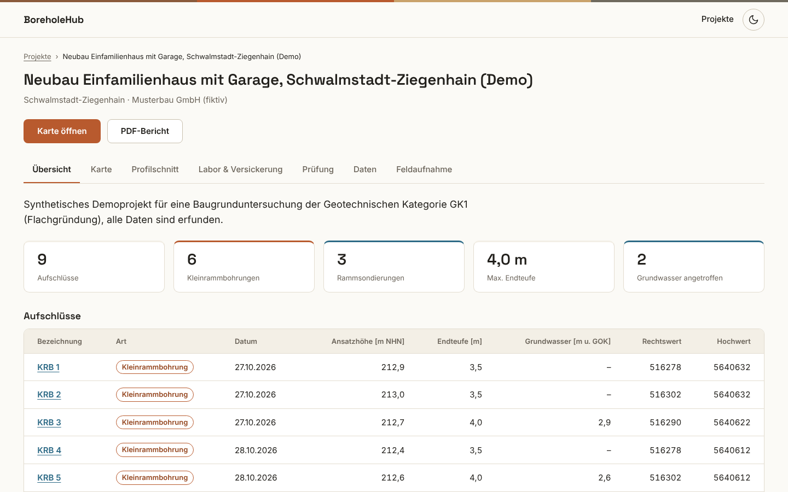
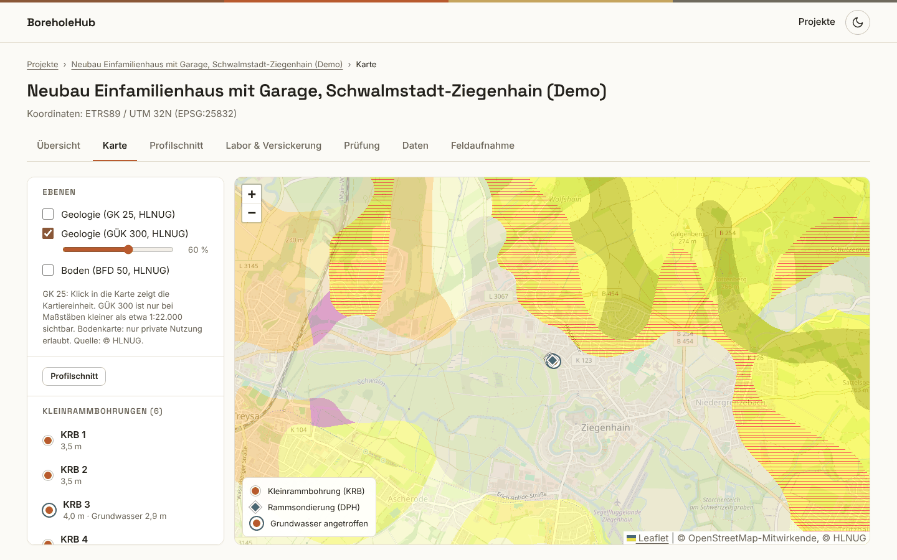
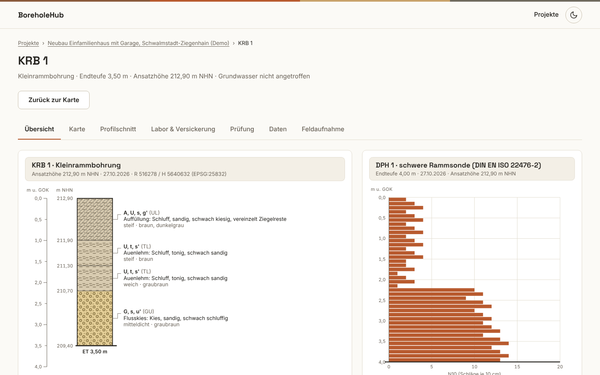
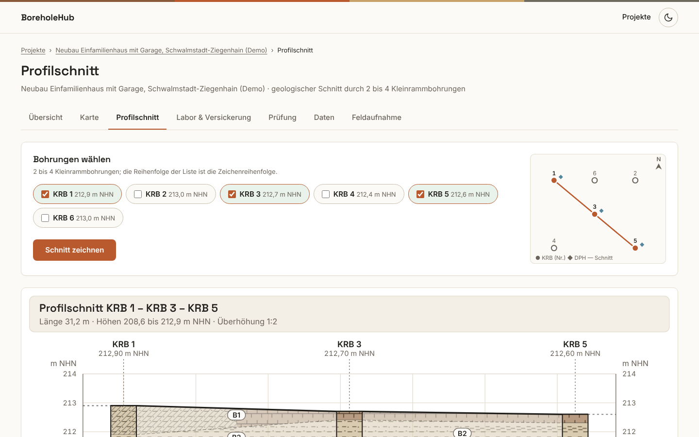
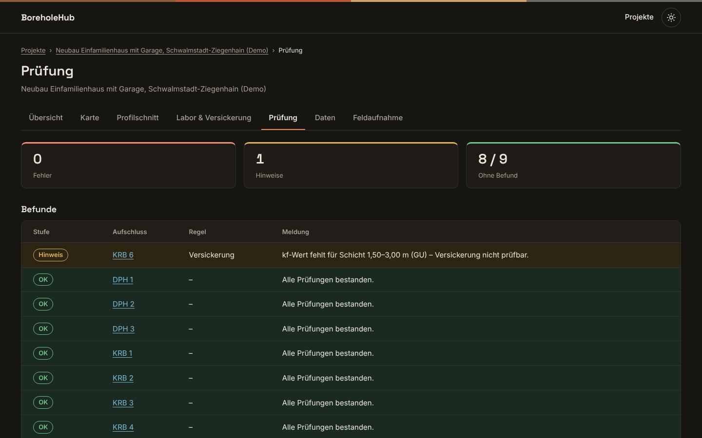
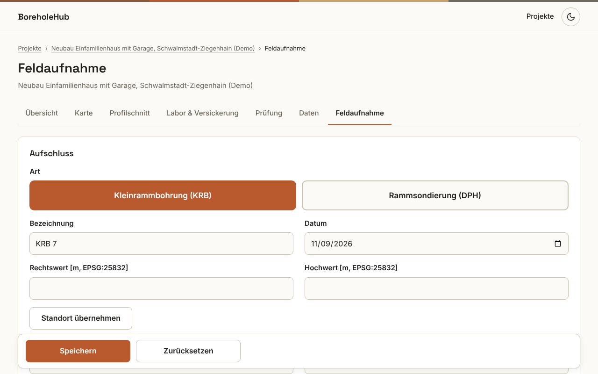

# BoreholeHub

English version: [README.en.md](README.en.md)

Demo für ein Baugrund-/Ingenieurgeologie-Büro (GK1): Kleinrammbohrungen, Rammsondierungen, Karte, Profilschnitt, Prüfung und PDF-Anlagen.



## Funktionen

- **Start:** Die Schaltfläche „Demo-Projekt laden“ legt ein Projekt mit synthetischen Daten an.
- **Projekte:** Liste aller Projekte.
- **Übersicht:** Kennzahlen, Tabelle der Aufschlüsse, Schaltfläche „PDF-Bericht“.
- **Karte:** Leaflet-Karte mit OpenStreetMap. Darüber lassen sich GK 25, GÜK 300 und die Bodenkarte BFD 50 (HLNUG) einblenden, jeweils mit Deckkraft-Regler. Klicks zeigen Popups.
- **Profilschnitt:** Geologischer Schnitt durch zwei bis vier ausgewählte Kleinrammbohrungen.
- **Labor & Versickerung:** Beispielhafte Einstufung nach den EBV-Klassen BM-0 bis BM-F3 und eine vereinfachte Versickerungs-Vorprüfung.
- **Prüfung:** Datenprüfung mit Fehlern, Hinweisen und unauffälligen Aufschlüssen.
- **Daten:** CSV-Vorlagen und CSV-Import sowie GeoJSON-Export.
- **Feldaufnahme:** Formular für das Tablet. Es erfasst Schichten bei Kleinrammbohrungen und Schlagzahlen N10 bei Rammsondierungen. Die Position lässt sich per „Standort übernehmen“ übernehmen.
- **Aufschluss:** Bohrprofil im vereinfachten Stil der DIN 4023 und Schlagzahl-Diagramm der Rammsondierung.
- **Darstellung:** Heller und dunkler Modus.

## Schnellstart

### A: SQLite (Standard)

Voraussetzung ist das .NET 8 SDK. Im Projektordner des Repositorys:

```
dotnet run --project src/BoreholeHub.Web
```

Die Konsole zeigt `Now listening on: http://localhost:5000`. Öffnen Sie diese Adresse und klicken Sie auf „Demo-Projekt laden“. Die Datenbank ist die Datei `boreholehub.db`. Sie entsteht beim ersten Start im Ordner `src/BoreholeHub.Web`.

### B: Windows-Paket mit SQL Server

`scripts\publish-win.cmd` (aus dem Repository-Ordner, .NET 8 SDK nötig) erzeugt das eigenständige Paket `publish\BoreholeHub-1.0.0-win-x64`. Darin startet `Start-BoreholeHub.cmd` die App mit `Database:Provider` = `SqlServer` und öffnet `http://localhost:5080`. Die Verbindungszeichenfolge aus `appsettings.json` lautet `Server=.;Database=BoreholeHub;Trusted_Connection=True;TrustServerCertificate=True`; die Datenbank wird beim ersten Start angelegt.

## Tests

```
dotnet test
```

Aktuell laufen 180 Tests, alle bestehen. Die Tests verwenden xUnit. Die Web-App startet dafür über `WebAppFactory`.

## Technik

- .NET 8 (`net8.0`), ASP.NET Core Razor Pages, C# mit aktivierten Nullable-Referenztypen. Die Version 1.0.0 steht in `Directory.Build.props`.
- Entity Framework Core 8.0.33 mit SQLite (Standard) und SQL Server. Das Schema legt die Anwendung beim Start mit `EnsureCreated` an.
- QuestPDF 2026.9.1 erzeugt den PDF-Bericht.
- Die Zeichnungen (Bohrprofil, Profilschnitt, Rammdiagramm, Lageplan) entstehen als SVG auf dem Server.
- Leaflet liegt lokal unter `wwwroot/lib/leaflet`. Die Oberfläche lädt die Schriften Inter und Space Grotesk über Google Fonts.
- Projektstruktur: `src/BoreholeHub.Core` (Entitäten, Dienste), `src/BoreholeHub.Web` (Razor Pages, Zeichnungen, Import, PDF), `tests/BoreholeHub.Tests`.
- Tests mit xUnit 2.5.3 und Microsoft.AspNetCore.Mvc.Testing 8.0.33.

## Fachliche Grundlagen

- Die Aufschlüsse sind Kleinrammbohrungen (KRB) und Rammsondierungen (DPH) der geotechnischen Kategorie GK1 mit einer Endteufe bis 4 m.
- Die Darstellung folgt den Normen in Anlehnung und vereinfacht: DIN 4023:2023-02 (Schichtenverzeichnis und Bohrprofil), DIN 18300:2019-09 (Homogenbereiche) und DIN EN ISO 22476-2 (DPH).
- Die EBV-Klassen BM-0 bis BM-F3 zeigt die App mit erfundenen Beispielwerten. Es sind keine gesetzlichen Grenzwerte.
- Zur Versickerung gilt: „Vereinfachte Vorprüfung: Der kf-Wert ersetzt keine Bemessung nach DWA-A 138-1.“
- Alle Projektdaten sind synthetisch und erfunden.

## Screenshots

| | |
|---|---|
|  02 Karte mit GÜK 300 |  03 Bohrprofil KRB 1 |
|  04 Profilschnitt |  05 Prüfung im dunklen Modus |
|  06 Feldaufnahme auf dem Tablet | |

## Datenquellen & Lizenzen

- Karte: © OpenStreetMap-Mitwirkende.
- GÜK 300: © HLNUG, Lizenz CC BY 4.0.
- GK 25: © HLNUG. Der Dienst nennt keine Lizenz.
- Bodenkarte BFD50: © HLNUG, angezeigt mit dem Hinweis „nur private Nutzung erlaubt“.
- PDF-Bericht: QuestPDF unter der Community-Lizenz.
- Schrift Inter: SIL Open Font License 1.1, Dateien in `src/BoreholeHub.Web/Fonts`.
- Leaflet: Lizenzdatei in `src/BoreholeHub.Web/wwwroot/lib/leaflet/LICENSE`.

## KI-Hinweis

Der Footer der App lautet: „Mit KI-Unterstützung erstellt, entworfen und geprüft von Sohrab Talebian Far · Version 1.0.0“.

## Kontakt

GitHub: https://github.com/ariasorhab
